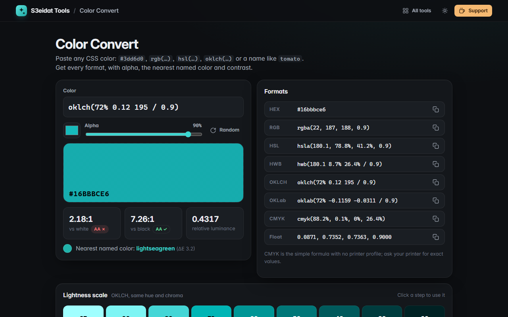

# Color Convert

> Convert any CSS color to HEX, RGB, HSL, HWB, OKLCH, OKLab and CMYK. Free, private, and it runs entirely in your browser.

### ▶ [Open Color Convert](https://s3eidat.github.io/color-convert/)



## Features

- **Reads any CSS color**: `#rgb`, `#rrggbbaa`, `rgb()`/`rgba()` (comma or space syntax, percentages), `hsl()`, `hwb()`, `oklch()`, `oklab()`, all 148 named colors and `transparent`
- **Every format** with a copy button: HEX, RGB, HSL, HWB, OKLCH, OKLab, CMYK and float RGB
- **Alpha** slider that keeps your format (`rgba`, `/ 0.5`, `#rrggbbaa`)
- **Big swatch** over a checkerboard, native color picker, random pleasant color
- **Nearest CSS named color** (measured in OKLab) and **WCAG contrast** against white and black
- **Lightness scale**: nine OKLCH steps of the same hue
- Warns when an OKLCH/OKLab color is **outside sRGB** and is clipped for HEX/RGB

Accurate maths: sRGB transfer curve, Björn Ottosson's OKLab matrices, and WCAG 2 relative luminance.
The built-in self-test checks known values (e.g. `#ff0000` = `oklch(62.8% 0.2577 29.23)`) and compares
the parser with the browser's own CSS color parser for every named color and a set of tricky inputs.

CMYK uses the simple formula with no printer (ICC) profile, so treat it as a starting point.

## Privacy

Nothing you type leaves your device. There is no server, no account, no analytics.
The page ships with a strict Content-Security-Policy (`connect-src 'self'`), so the browser
itself blocks any attempt to send data anywhere.

## Run it yourself

It's plain HTML, CSS and JavaScript with no build step:

```bash
git clone https://github.com/s3eidat/color-convert
cd color-convert
python -m http.server 8000
```

Then open http://localhost:8000.

## Support

If this saved you time, **[buy me a coffee ☕](https://s3eidat.github.io/coffee/)**. It keeps every tool free.

---

Part of **[S3eidat Tools](https://s3eidat.github.io/)**: 100+ free, private tools that run in your browser. MIT licensed.
